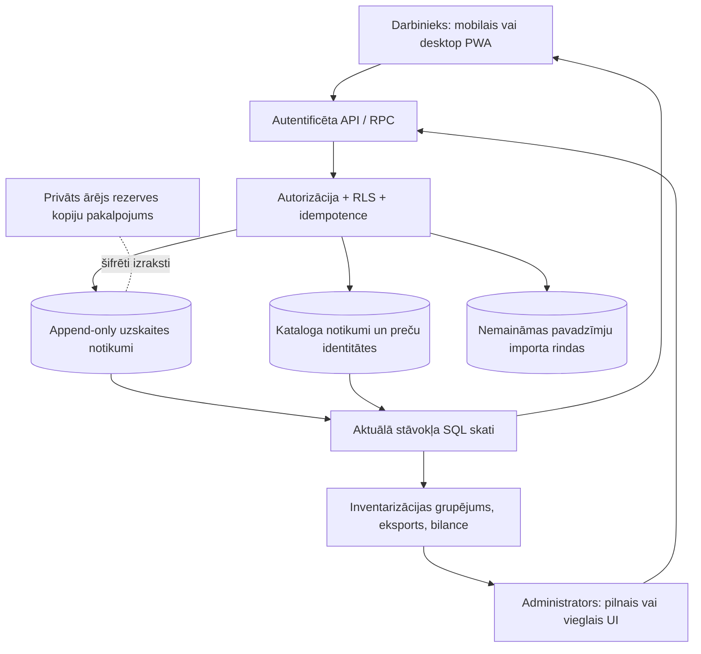
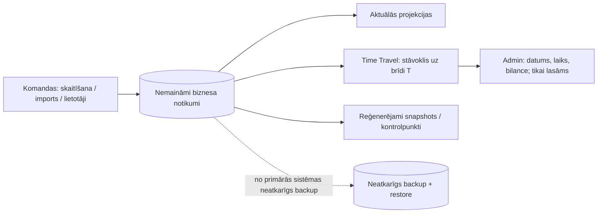

**AKTUĀLĀ PLATFORMAS TOPOLOĢIJA (v0.1.6):** Netlify PWA un server functions pēc vajadzības, Supabase PostgreSQL/Auth ar RLS un atomiskām servera funkcijām, privāts GitHub kodam. Datu notikumu, kataloga un bilances shēma zemāk ir projektēšanas skice, ne migrācija. Atvērtas backup (Netlify Blobs Beta kā viena iespēja) un Free plānu pieejamības pārbaudes. Sk. `29_SELECTED_STACK_IMPLEMENTATION_GATE.md`.

# Piedāvātā sistēmas arhitektūra — SKICE, nav implementēta

## Platformas virziens
Privāts GitHub repozitorijs → Cloudflare Pages (PWA statiskā saskarne; pakalpojums izvēlēts kā kandidāts) → Supabase Auth + PostgreSQL, drošas RPC/Edge Functions administratīvām operācijām. Neviena produkcijas vide šajā posmā nav uzstādīta.

## Kandidātdatubāzes entītijas (nevis gatavas migrācijas)
| Entītija | Saturs / uzdevums | Ierobežojums |
|---|---|---|
| `inventory_years` | Gads, statuss draft/active/reconciliation/closed, atvēršanas/slēgšanas notikumi | Gads ir skaidri definēts, nevis slepens PHP globālais mainīgais |
| `inventory_entry_events` | Jauns ieraksts, labojums, loģiska anulēšana kā atsevišķi nemaināmi notikumi | `event_id`, `logical_entry_id`, `actor_id`, `server_timestamp`, `request_id` |
| `inventory_current` | Atvasināts aktuālais stāvoklis katram `logical_entry_id` | Skats/atjaunojama projekcija; nav patiesības avots |
| `catalogue_products` | Iespējamā pastāvīgā preces identitāte | Preces identitātes noteikumi vēl jāapstiprina |
| `catalogue_variants` | Cena, nosaukums, kods, gada un avota vēsture | Daudz pret vienu ar preces identitāti, var pastāvēt cenu varianti |
| `barcode_links` | Skenētais simbolu kods, simboloģija, pārbaudītā saite uz produktu | NAV attēlu; kods saglabāts kā teksts ar sākuma nullēm |
| `invoice_import_batches` | Importa izcelsme, SHA-256, faila metadati, apstiprinājuma statuss | Atkārtotam importam nepazūd auditējamība |
| `invoice_raw_rows` | Nemaināmas teksta vērtības no importētā avota | Normalizācija/parsēšana notiek ārpus RAW |
| `catalogue_change_events` | Kataloga papildinājumi, sasaistes, cenu izmaiņas, ieviesējs | Apstiprināts lēmums = jauns notikums |
| `year_close_exports` | Noslēgta perioda eksporta identifikators, dokumentu hash, parakstītājs | Iespējams pilnībā reproducēt noslēgto versiju |
| `user_profiles` | Loma, darba profils, deaktivizācija | Auth konti netiek fiziski dzēsti, ja piesaistīti auditam |

## Pieprasījuma ceļš — jauns inventarizācijas ieraksts
1. Klients ģenerē `request_id` un nosūta vienu validētu komandu.
2. Serveris pārbauda lietotāju, lomu, aktīvo gadu, ievadi, preces/varianta pieļaujamību.
3. Unikālā `request_id` ierobežojumā transakcija pievieno **vienu** `inventory_entry_events` notikumu.
4. Serveris atgriež notikuma ID, servera laiku un aktuālo ierakstu; bez apstiprinājuma UI nerāda 'saglabāts'.
5. Ja tīkla kavēšanās dēļ lietotājs atkārto to pašu pieprasījumu, serveris atgriež tā paša notikuma rezultātu, nedublējot uzskaiti.

## Gada katalogs
Imports → RAW rindas → normalizācijas/validācijas priekšskatījums → grupētas atšķirības un konflikti → administratora apstiprinājums → kataloga notikumi → atvasināts aktuālais gada katalogs.

## Projektējot jāatceras
PWA galvenokārt ir interfeiss, nevis datu integritātes nodrošinātājs. Galvenā kontrole ir PostgreSQL transakcijas, ierobežojumi un pareizi pieejas noteikumi. `SECURITY DEFINER` funkcijas var būt vajadzīgas, bet tām jāpārskata īpašnieka tiesības un drošs `search_path`.

## Vēsturiskā stāvokļa projekcija un atgūstamība — papildinājums v0.1.1
Vēsturiski jārekonstruē inventarizācija **kopā ar katalogu, cenu versijām un apstiprinātām pavadzīmēm**; lietotāju tiesību vēsture jānodala no pašas autentifikācijas atkopes. Pašreizējā platformu diagramma ir **kandidāts**, ne datu saglabāšanas arhitektūras priekšnoteikums.

Pilna semantika un robežas: `23_TEMPORAL_HISTORY_AND_RECOVERY.md`; `Q-018..Q-023`.

## v0.1.2 — alternatīvā vienas platformas arhitektūra
Skat. `24_PLATFORM_CONSOLIDATION.md`. Alternatīva Supabase+Cloudflare: GitHub (private) → Cloudflare Workers/Pages (PWA+API+autentifikācija) → D1 (append-only ledger) → privāta R2 rezerves krātuve; neregulāri šifrēti cold exports ārpus konta. SQLite grāmatvediskā precizitāte, 500 MB Free DB un 10ms CPU/Workers Free ir **atvērtie piemērotības vārti**, ne pārbaudīta atbilstība. Stāvokļa apskati laikā NErealizēt ar destruktīvu D1 Time Travel atjaunošanu.

## Architecture option v0.1.4
The user proposed keeping the source in private GitHub; deploying the PWA and selected server endpoints on Cloudflare; storing backups in a private R2 bucket; and running the canonical immutable event ledger, catalogue, prices, Auth and RLS in Supabase PostgreSQL. Details, alternative access routing, full logical dump limitations and restore gates: `docs/27_HYBRID_CLOUDFLARE_SUPABASE.md`. This does not replace platform-neutral domain modeling or previous alternatives until approved.
